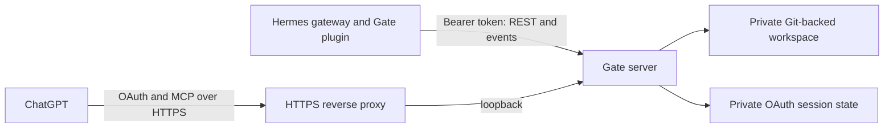

# Gate and Hermes

Gate stores shared Markdown knowledge, identities and tasks. The separately installed Hermes plugin connects as a registered identity. Its listener runs inside the Hermes gateway and subscribes to task events; no separate listener command is needed.

For a same-machine setup, Hermes connects directly to `http://127.0.0.1:18084`. Remote clients use an HTTPS origin. The Hermes machine token and ChatGPT OAuth credentials are separate. All authenticated identities currently have equal data access; event filtering is not an access-control boundary.

## Events and claims

`GET /whoami` returns the authenticated identity. `GET /events` accepts bearer authentication, an optional numeric `Last-Event-ID`, and an optional `responsible` filter that defaults to the token identity. It sends server-sent events:

- `task`: task ID, event type, current and previous responsibility, status, revision and timestamp.
- `ready`: replay is complete; reconcile the current task snapshot.
- `checkpoint`: a high-water cursor, including changes irrelevant to the identity.
- `reset`: the cursor is ahead of server history; reconcile the snapshot.

Keepalive comments are sent every 15 seconds. Clients reconnect and authenticate again after a disconnect. Task state, event log and write receipt are committed together, and events can be replayed after a server restart. The server admits up to 32 concurrent streams.

`POST /tasks/{id}/claim` accepts JSON `{"run_id":"client-generated-unique-id"}` with `If-Match` and `Idempotency-Key` headers. Only the responsible identity can claim an `open` or `ready` task. A successful claim sets the task to `in_progress` and records the run ID. An exact retry returns the same claim; a competing claim with an old ETag receives 412. Reopening or reassigning clears the run ID. Clients do not include server-managed run metadata in task PUT bodies.

The plugin persists its cursor and run stages. If a worker stops during execution, the run may require review: replay and claims cannot guarantee that external side effects happen exactly once. Reassignment does not undo work already performed.

See [SETUP.md](../SETUP.md) for local setup and [self-hosting](self-host.md) for HTTPS deployment.
